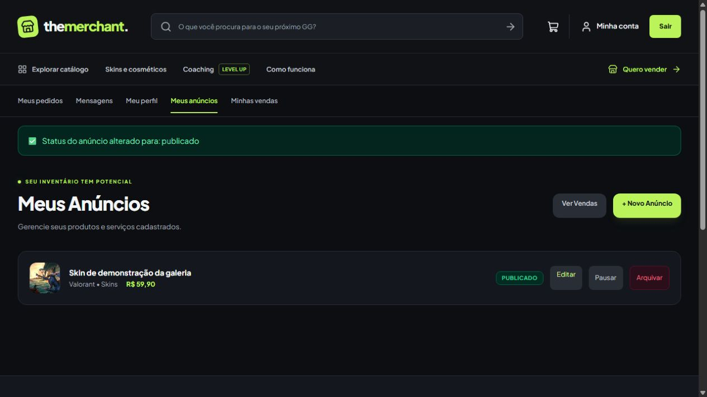
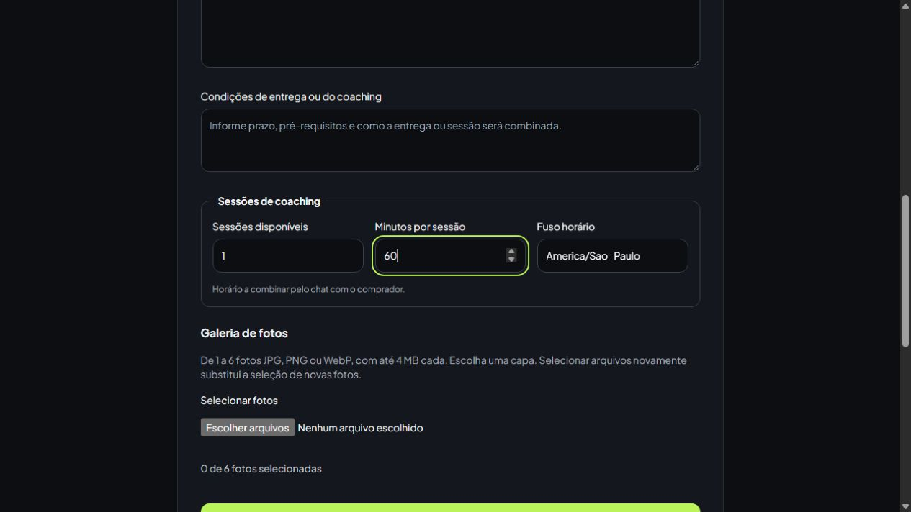

# Aceite técnico — issue #6

Implementação de RF05, RF06 e RNF03 na branch `João`, em 29/10/2026.
Issue: [CRUD de anúncios e galeria](https://github.com/IgorMarcoli/TheMerchant/issues/6).

## Comportamento entregue

- Cadastro e edição compartilham o formulário com validação em `ListingStoreRequest`/`ListingUpdateRequest`.
- `ListingService` concentra transações, uploads, capa, atualização e arquivamento; o controller delega o fluxo.
- Galeria de 1 a 6 imagens JPG/PNG/WebP de até 4 MB cada, prévias, escolha da capa, remoção e inclusão de fotos na edição.
- O limite considera fotos mantidas e novas juntas; IDs de fotos alheias, capa inválida, arquivos falsificados e galeria vazia são rejeitados.
- Fotos novas têm nomes únicos, visibilidade pública e disco persistido em `listing_images.disk`. O driver `local` usa `public` para uploads de anúncios; S3 continua sendo respeitado quando configurado. Fotos antigas sem disco mantêm o comportamento anterior.
- Falhas de upload ou persistência revertem registros e tentam remover todos os arquivos novos, inclusive uma escrita parcialmente concluída. Fotos antigas só são removidas após commit. Falha na limpeza fica registrada no log.
- Pausa/reativação usa Policy e revalida jogo/categoria ao reativar. Anúncios bloqueados, vendidos ou arquivados não podem ser republicados pela área do vendedor.
- Edição alheia retorna 403; administrador ativo pode administrar ofertas de outros vendedores. Criar anúncios continua exigindo perfil de vendedor aprovado, inclusive para administradores.
- Excluir da vitrine agora significa arquivar (`archived_at`), preservando anúncio, fotos, pedidos, itens, vendas e conversas. Catálogo, detalhes públicos, novas compras e novas conversas não aceitam anúncios arquivados; participantes e compradores existentes mantêm acesso ao histórico/chat.
- Cosmético tem capacidade 1, sem duração/fuso. Coaching exige sessões inteiras positivas, duração de 1 a 1440 minutos, condições de entrega e fuso IANA; o preço é por sessão e o horário é a combinar pelo chat.
- Jogo/categoria precisam estar ativos; categorias globais ou do jogo escolhido são permitidas. Havendo itens de pedido, jogo, categoria, capacidade, duração, condições e fuso ficam protegidos de edição para preservar o contrato existente.

## Validações

| Verificação | Resultado local |
| --- | --- |
| Suíte PHP completa, SQLite em memória | 141 testes, 797 assertions |
| Testes específicos do painel/armazenamento | 23 testes: permissões, uploads, edição, falhas, arquivamento e regras por tipo |
| Testes JavaScript | 22 testes, incluindo 4 da galeria |
| Build Vite | Aprovado |
| Pint PSR-12 e `git diff --check` | Aprovados |

Teste de navegador em ambiente descartável separado: login como vendedor fictício, edição, escolha da segunda foto como capa, remoção da primeira, mudança de preço, gravação sem reenviar fotos, pausa/reativação e exibição dos campos de coaching. O `.env` e o banco de desenvolvimento não foram alterados.

## Aplicação da migration

Em cada ambiente da aplicação, execute `php artisan migrate` para aplicar `2026_10_29_000001_complete_seller_listings`. Para armazenamento público local, mantenha `php artisan storage:link` configurado. A migration acrescenta colunas e preserva os dados existentes. Ofertas antigas de coaching precisam completar os novos dados antes de serem reativadas.

O Docker carrega `docker/php-uploads.ini`: limite individual de 4 MB e corpo POST de 32 MB para comportar as seis imagens. Em execução local sem Docker, aplique os mesmos limites ao `php.ini` usado pelo servidor e reinicie-o. O `php.ini` instalado na máquina não foi modificado por esta entrega.

## Limite em relação ao contrato #29

Esta entrega cobre publicação/edição por tipo e preservação dos anúncios. O consumo de capacidade, reservas com expiração, concorrência de checkout e snapshots completos continuam pertencendo às issues #13/#14. A proteção conservadora impede alterar capacidade/contrato quando há qualquer pedido; não substitui o cálculo de saldo reservado dessas issues. A integração real com S3 não foi exercitada: os testes usam discos simulados.
