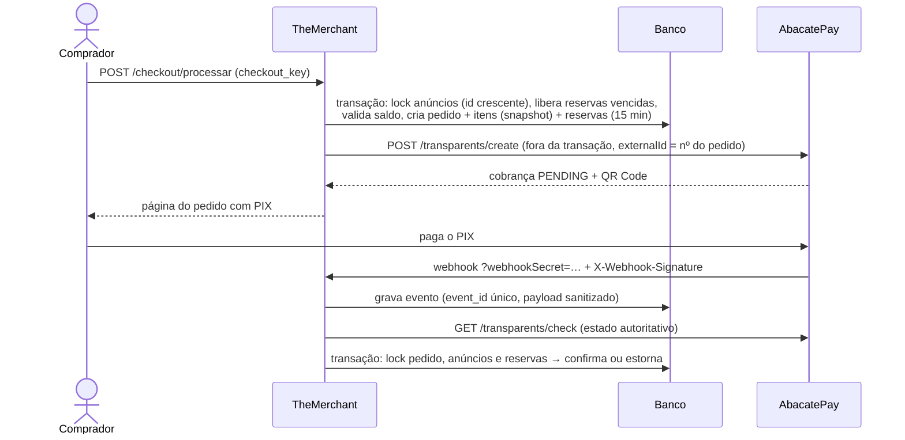

# Checkout, reservas e pagamentos — AbacatePay (PIX)

Implementação das issues [#13](https://github.com/IgorMarcoli/TheMerchant/issues/13) e
[#14](https://github.com/IgorMarcoli/TheMerchant/issues/14) sobre o
[contrato de domínio v1](CONTRATO_DOMINIO.md). Requisitos: RF10, RF11, RF12, RNF03, RNF04, RNF06 e RNF09.

## 1. Decisão de gateway

| Item | Decisão |
| --- | --- |
| Provedor | **AbacatePay**, API v2 (`https://api.abacatepay.com/v2`) |
| Produto | Checkout Transparente **PIX** (`POST /transparents/create`), com QR Code exibido na própria página do pedido |
| Motivo | Recebe o valor em centavos sem cadastrar produtos, aceita `expiresIn` (casa com o TTL da reserva) e `externalId` idempotente, e tem modo de desenvolvimento com simulação de pagamento |
| Dados sensíveis | Nenhum dado de cartão trafega pela aplicação (RNF04). O cliente não é enviado ao provedor; os dados do pagador no webhook são descartados |
| Sandbox | Chave de API de desenvolvimento (dev mode) + `POST /transparents/simulate-payment` |

Documentação oficial consultada: [Checkout Transparente](https://docs.abacatepay.com/pages/transparents/create),
[consulta de status](https://docs.abacatepay.com/pages/transparents/check),
[estorno](https://docs.abacatepay.com/pages/transparents/refund),
[webhooks](https://docs.abacatepay.com/pages/webhooks) e
[segurança dos webhooks](https://docs.abacatepay.com/pages/webhooks/security).

## 2. Fluxo



1. **Checkout** (`CheckoutService`): revalida elegibilidade, quantidade e preço. Se o preço mudou, atualiza o carrinho e pede revisão. Numa única `DB::transaction`, bloqueia os anúncios por id crescente (`lockForUpdate`), libera reservas vencidas, confere `available = capacity − reservado` e cria pedido, itens e reservas. Qualquer falha reverte tudo (D12). O mesmo `checkout_key` devolve o mesmo pedido.
2. **Cobrança** (`PaymentGatewayService::startPayment`): fora da transação. O PIX vence 60 s antes da reserva, para reduzir pagamentos tardios. Recusa definitiva do provedor libera a reserva e devolve os itens ao carrinho. Timeout/5xx mantém a reserva e a página oferece "Gerar PIX novamente", com o mesmo `externalId`.
3. **Webhook** (`WebhookController`): exige `webhookSecret` correto **e** HMAC-SHA256 do corpo bruto válido (`X-Webhook-Signature`, base64). Grava o evento uma vez por `event_id` e despacha `ProcessPaymentWebhookJob`.
4. **Processamento**: o corpo do webhook nunca confirma pagamento. O job consulta `GET /transparents/check` e aplica o estado sob locks (`applyCharge`).
5. **Reconciliação** (`php artisan payments:reconcile`, a cada minuto): consulta cobranças pendentes (webhook perdido), expira pedidos vencidos e reenvia estornos que falharam.

## 3. Estados e transições

| Entidade | Estados | Transições válidas | Responsável |
| --- | --- | --- | --- |
| Pedido (`orders.status`) | `pendente`, `pago`, `em_andamento`, `concluido`, `cancelado` | `pendente → pago` (pagamento verificado com reservas válidas); `pendente → cancelado` (expiração, recusa, cancelamento, falha definitiva do gateway, pagamento tardio); `pago → concluido` (todas as entregas, #18) | `PaymentGatewayService`, `ReservationService`, `SaleDeliveryService` |
| Pagamento (`payments.status`) | `pending`, `paid`, `expired`, `cancelled`, `failed`, `refunded`, `disputed` | `pending → paid / expired / cancelled / failed`; `paid → refunded / disputed`. **`paid` nunca volta** para `pending`/`expired`/`failed` | `PaymentGatewayService` |
| Estorno (`payments.refund_status`) | `null`, `pending`, `failed`, `refunded` | `null → pending` (pagamento tardio); `pending/failed → refunded` ou `failed` (com nova tentativa) | `RefundLatePaymentJob`, `payments:reconcile` |
| Reserva (`reservations.status`) | `active`, `confirmed`, `released` | `active → confirmed` (pagamento válido, baixa `capacity`); `active → released` (`expired`, `gateway_failure`, `late_payment`, `cancelled`, `failed`). `confirmed` nunca é liberada | `CheckoutService`, `PaymentGatewayService`, `ReservationService` |
| Item (`order_items.delivery_status`) | `aguardando_pagamento`, `em_entrega`, `entregue` | `aguardando_pagamento → em_entrega` na confirmação; `→ entregue` pelo vendedor (#18) | `PaymentGatewayService`, `SaleDeliveryService` |

Mapeamento de status do provedor: `PENDING → pending`; `PAID`/`APPROVED → paid`; `EXPIRED → expired`;
`CANCELLED → cancelled`; `FAILED`/`REDEEMED → failed`; `REFUNDED → refunded`; `UNDER_DISPUTE → disputed`.
Status desconhecido é tratado como falha transitória, nunca como aprovação.

**Pagamento tardio** (D06, D13): se a aprovação é processada quando `now >= expires_at`, a reserva já foi
liberada ou o valor diverge do pedido, o pagamento é registrado como `paid` com `refund_status = pending`. O pedido
fica `cancelado`, sem consumir capacidade nem liberar entrega, e o estorno integral é solicitado
(`POST /transparents/refund`). Repetir o estorno não duplica: o provedor responde "já foi reembolsada" e isso é tratado como concluído.

**Estorno ou disputa após confirmação**: registra o status no pagamento e gera log de alerta, sem repor saldo.
Exige reconciliação manual auditável (contrato #29, seção 2).

## 4. Idempotência

| Situação | Garantia |
| --- | --- |
| Duplo clique / reenvio do checkout | `UNIQUE(buyer_id, checkout_key)`; a mesma chave devolve o mesmo pedido |
| Criação da cobrança repetida | `payments.idempotency_key = abacatepay:<nº do pedido>` (UNIQUE) + `externalId` no provedor |
| Webhook reenviado (mesmo `id`) | `payment_events.event_id` UNIQUE; evento já processado não é reprocessado |
| Eventos diferentes do mesmo pagamento | Estado conferido no provedor e aplicado sob lock; confirmação repetida não baixa saldo de novo |
| Estorno repetido | `refund_status` + resposta "já reembolsada" do provedor |

## 5. Configuração

```dotenv
PAYMENT_GATEWAY=abacatepay
ABACATEPAY_API_KEY=            # chave de desenvolvimento enquanto estiver em dev mode
ABACATEPAY_WEBHOOK_SECRET=     # o mesmo segredo informado ao cadastrar o webhook
ABACATEPAY_DEV_MODE=true       # mostra o botão "Simular pagamento" (somente dev)
```

No painel da AbacatePay, cadastre o webhook com o evento `transparent.completed` (e, se quiser, `transparent.refunded`/`transparent.disputed`)
apontando para:

```
https://themerchant-p2be.onrender.com/api/webhooks/payment?webhookSecret=<ABACATEPAY_WEBHOOK_SECRET>
```

O endpoint precisa ser HTTPS público. Em `localhost` o webhook não chega. Use o botão **"Já paguei — atualizar status"**
(consulta o provedor) ou **"Simular pagamento (modo dev)"**.

Processos necessários: o `docker/entrypoint.sh` sobe `php artisan schedule:work` (desative com `RUN_SCHEDULER=false`) e,
quando `QUEUE_CONNECTION` não é `sync`, `php artisan queue:work` (desative com `RUN_QUEUE_WORKER=false`).

## 6. Homologação em sandbox (#16)

1. Configure as variáveis acima com a chave de **desenvolvimento** e publique.
2. Compre um cosmético e um serviço; confira o QR Code e o pedido `pendente`.
3. Clique em "Simular pagamento (modo dev)" ou chame `POST /v2/transparents/simulate-payment?id=<pix_char_…>`.
4. Confira: pedido `pago`, cosmético `vendido`, serviço com `capacity` reduzida, item `em_entrega` e o evento em `payment_events`.
5. Aguarde 15 minutos sem pagar outro pedido e rode `php artisan payments:reconcile`; confira pedido `cancelado` e reserva `released`.
6. Registre as evidências sem a chave de API nem o segredo do webhook.

## 7. Cobertura automatizada

`tests/Feature/CheckoutReservationTest.php`, `tests/Feature/WebhookPaymentTest.php` e `tests/Unit/AbacatePayGatewayTest.php`
simulam a API do provedor com estado por cobrança (`tests/Concerns/InteractsWithAbacatePay.php`).

| Cenário do contrato | Teste |
| --- | --- |
| D01, D02, D03, D04, D05, D06, D09, D10, D11, D12, D13, D14 | `CheckoutReservationTest::test_dNN_*` |
| D07, D08 (entrega/avaliação por item) | `OrderTest`, `ReviewTest` (já existentes) |
| Webhook sem segredo/assinatura, payload forjado, valor divergente, sanitização, duplicidade | `WebhookPaymentTest` |
| Classificação de falhas, mapeamento de status, estorno repetido | `AbacatePayGatewayTest` |

Limitação: D04 é verificado sequencialmente (SQLite em memória não executa transações concorrentes). A serialização
real depende do `SELECT … FOR UPDATE` no PostgreSQL e deve ser evidenciada na homologação (#16).
